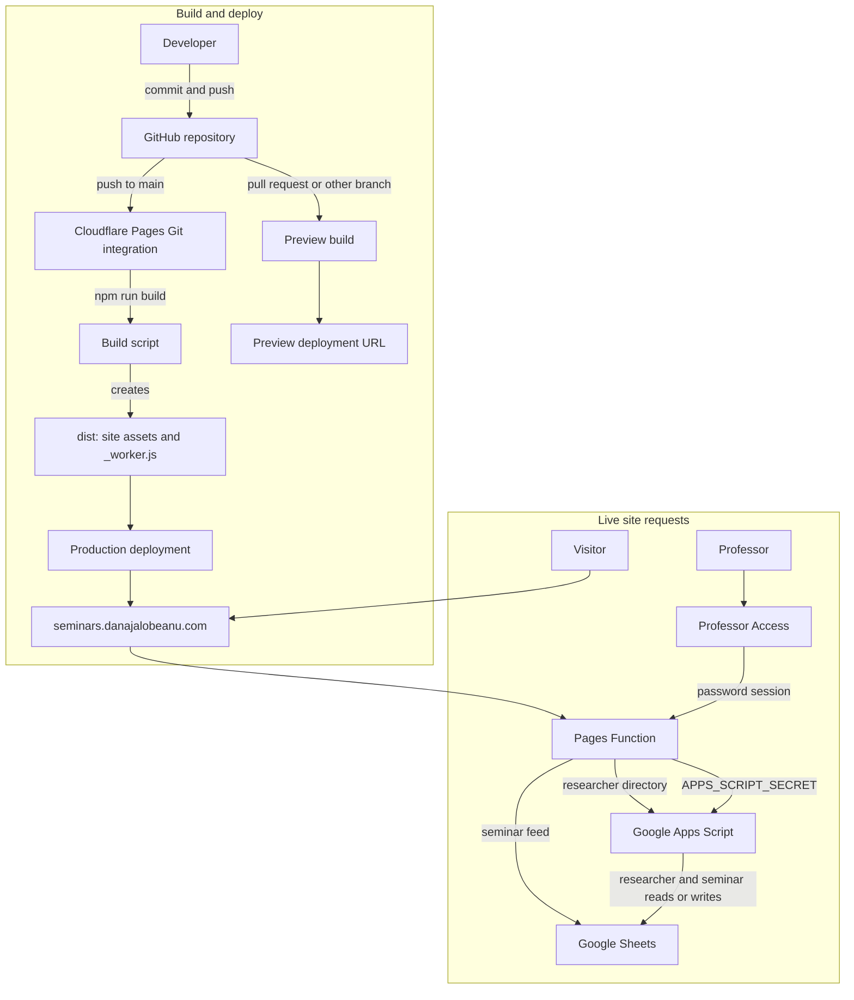

# Early Modern Lab seminar website

This is the setup and maintenance guide for the website. Use the section that matches the task; you do not need to rebuild the whole installation to fix one broken part.

For ordinary seminar changes, use the [professor editor](https://seminars.danajalobeanu.com/admin). Adding or editing a seminar does not require a website deployment.

## Find the instructions you need

| Task | Instructions |
| --- | --- |
| Fix a broken website | [Troubleshooting](#troubleshooting) |
| Publish website changes | [Update the website](#update-the-website) |
| Set up a new installation | [Set up the site](#set-up-the-site) |
| Connect or repair the domain | [DNS setup](#dns-setup) |
| Reset the editor password | [Reset the admin password](#reset-the-admin-password) |
| Repair saving in the editor | [The editor loads, but saving fails](#the-editor-loads-but-saving-fails) |
| Work on the site locally | [Local development](#local-development) |
| Change the default meeting link or venue | [Change the editor defaults](#change-the-editor-defaults) |
| Find the relevant source file | [Files and responsibilities](#files-and-responsibilities) |

## Current production setup

These details were last checked on 14 October 2026. Update this table when an account, domain, or service is moved.

| Item | Current value |
| --- | --- |
| Public website | [seminars.danajalobeanu.com](https://seminars.danajalobeanu.com/) |
| Professor editor | [seminars.danajalobeanu.com/admin](https://seminars.danajalobeanu.com/admin) |
| Pages address | [philosophy-seminars-site.pages.dev](https://philosophy-seminars-site.pages.dev/) |
| Repository | [sagnikdas-ml/Philosophy-Seminars-Site](https://github.com/sagnikdas-ml/Philosophy-Seminars-Site) |
| Cloudflare project | `philosophy-seminars-site`, type **Pages** |
| Cloudflare dashboard | [Workers & Pages in the current account](https://dash.cloudflare.com/74dc493753dd71aab1ca76dfeb2279aa/workers-and-pages) |
| Production branch | `main` |
| Deployment method | Cloudflare Pages Git integration; push to `main` deploys production |
| Spreadsheet | [Open the current Google Sheet](https://docs.google.com/spreadsheets/d/1lb5uZfeaZEmB-ZH7DwzFFtzEIX2ItcwUX8Mvza0pxp0/edit#gid=0) |
| Spreadsheet tab ID | `gid=0` in the CSV address |
| Read and write service addresses | `GOOGLE_SHEET_CSV_URL` and `GOOGLE_APPS_SCRIPT_URL` in [wrangler.toml](wrangler.toml) |
| DNS provider | WordPress.com; current nameservers are `ns1.wordpress.com`, `ns2.wordpress.com`, and `ns3.wordpress.com` |
| Website DNS record | `seminars` → `philosophy-seminars-site.pages.dev`, type `CNAME` |

**GitHub is connected to Cloudflare Pages.** A push to `main` triggers the production build; pull requests and other branches create preview deployments. Cloudflare builds the repository with `npm run build` and publishes `dist/`. Keep Cloudflare secrets in the Pages project settings, not in GitHub or the repository.

### Deployment and request flow



GitHub provides the source and starts builds. Cloudflare Pages runs the build, supplies the configured runtime variables and secrets, and serves the deployment. Public seminar and researcher data continue to come from Google Sheets and Apps Script.

When diagnosing a failure, separate these three parts:

| Part | Responsibility | Typical failure |
| --- | --- | --- |
| Cloudflare Pages | Pages, editor login, validation, and requests | A page or editor request fails |
| Seminar data services | Public reads and saved seminar changes | Seminars are missing or saving fails |
| DNS and the Pages custom-domain setting | Connect the public hostname to Pages | Custom address fails while `pages.dev` works |

## Before you begin

You need access to the source files and the Cloudflare account containing the Pages project. For data or write-service repairs, you also need the relevant Google account.

There are two different secrets:

| Setting | Where it belongs | Purpose |
| --- | --- | --- |
| `ADMIN_PASSWORD` | Cloudflare Pages | The password entered in the professor editor |
| `APPS_SCRIPT_SECRET` | Cloudflare Pages | Authorizes seminar changes |
| `API_SECRET` | Apps Script project properties | Must have exactly the same value as `APPS_SCRIPT_SECRET` |

The editor password is separate from the shared write secret. Changing one does not fix the other.

Keep real values in a password manager, outside this README and `wrangler.toml`. The project ignores `.dev.vars` and some local secret filenames, but a newly named file is not automatically protected. Inspect `git status --short` and `git diff --cached --name-only` before committing files.

## Set up the site

For the existing working installation, use [Update the website](#update-the-website). The following steps are for a new installation or rebuilding a missing service.

### Step 1: Install the tools and open the folder

Install [Node.js](https://nodejs.org/en/download) version **22 or newer** and [Git](https://git-scm.com/downloads). The locked Wrangler dependency requires Node 22 or newer; this workspace has been used with Node 24.

In VS Code, open **Terminal → New Terminal**. Run commands from the folder containing `package.json` and `wrangler.toml`.

If you do not already have the source files:

```sh
git clone https://github.com/sagnikdas-ml/Philosophy-Seminars-Site.git
cd Philosophy-Seminars-Site
```

If this folder is already open, skip cloning it again.

Check the tools, then install the recorded dependencies:

```sh
node --version
npm --version
git --version
npm ci
```

Use `npm ci` with the included lockfile. A missing `node_modules` directory is normal before installation.

### Step 2: Prepare the seminar data

For the existing site, check the current spreadsheet rather than creating another one. For a new installation:

1. Create a spreadsheet and name the seminar tab `Seminars`.
2. Before entering new data, select the columns and choose **Format → Number → Plain text**. This keeps dates and times in the expected format.
3. Put the following headers in row 1, one per column:

```text
date,speaker,title,link,speaker_detail,speaker_portfolio,time,end_time,timezone,venue,abstract,published
```

If the line pastes into a single cell, use **Data → Split text to columns** with a comma separator.

| Column | Required | Example or meaning |
| --- | --- | --- |
| `date` | Yes | `2026-11-18`; format `YYYY-MM-DD` |
| `speaker` | Yes | `Dana Jalobeanu` |
| `title` | Yes | Talk title |
| `link` | No | Complete meeting or registration link |
| `speaker_detail` | No | Affiliation or a short detail |
| `speaker_portfolio` | No | Complete link to the speaker's website |
| `time` | No | `17:00`; 24-hour time |
| `end_time` | No | `19:00`; 24-hour time |
| `timezone` | No | Prefer `Europe/Berlin` for this series |
| `venue` | No | Room or venue |
| `abstract` | No | Abstract; line breaks are supported |
| `published` | No | `yes` for published, `no` for draft; blank means published |

Header order can differ, but the names must match. Existing sheets need at least `date`, `speaker`, and `title`; missing optional columns are added by the write service. Starting with all twelve avoids ambiguity.

Keep records in consecutive rows below the header. A completely blank row between seminars can make the editor's calculated row numbers disagree with the spreadsheet. Remove unused rows rather than leaving gaps in the middle.

4. Allow reading without a Google sign-in, for example through **Share → General access → Anyone with the link → Viewer**, where the account permits it.
5. Copy the spreadsheet ID from its address: the part between `/d/` and `/edit`.
6. Select the seminar tab and note the `gid` in the address. The tab name and `gid` are different identifiers.
7. Build the CSV address:

```text
https://docs.google.com/spreadsheets/d/YOUR_SPREADSHEET_ID/export?format=csv&gid=YOUR_TAB_GID
```

Open it in a private browser window. It should download or show CSV without requiring sign-in, and the first line should contain the headers. A Google login page is not a working feed.

**Draft is a display setting, not confidential storage.** The public CSV contains the rows, and the website filters out those marked `no`. Keep confidential notes and personal information out of this data source.

### Step 3: Check the write service

The existing installation already has an Apps Script web app. Keep using it. Its deployed address is `GOOGLE_APPS_SCRIPT_URL` in `wrangler.toml`.

For a new installation only:

1. Create a project at [Google Apps Script](https://script.google.com/) and replace its starter code with [apps-script/Code.gs](apps-script/Code.gs).
2. Generate a shared secret and save it in a password manager:

   ```sh
   node -e "console.log(require('node:crypto').randomBytes(32).toString('hex'))"
   ```

3. In the project's script properties, set `SHEET_ID` to the spreadsheet ID, `SHEET_NAME` to the tab name, and `API_SECRET` to that generated value. Save.
4. Deploy a **Web app**, executing as the spreadsheet owner, with access set to **Anyone**. Complete authorization and copy the address ending in `/exec`.

Use the same generated value for Cloudflare's `APPS_SCRIPT_SECRET`. The configured tab name must identify the same tab as the CSV address's `gid`.

Opening the deployed address should return:

```json
{"ok":true,"service":"early-modern-lab-seminars"}
```

This checks that the service responds, not that saving works. Use `/exec` for production; `/dev` is a restricted test address. Google's [web app instructions](https://developers.google.com/apps-script/guides/web) cover the deployment screens if needed.

### Step 4: Set the service addresses

Open [wrangler.toml](wrangler.toml). For the existing installation, its addresses are already populated. For a new installation, replace them with the addresses from Steps 2 and 3.

Retain the Pages settings:

```toml
name = "philosophy-seminars-site"
pages_build_output_dir = "./dist"
compatibility_date = "2026-09-21"

[vars]
GOOGLE_SHEET_CSV_URL = "https://docs.google.com/spreadsheets/d/YOUR_SPREADSHEET_ID/export?format=csv&gid=YOUR_TAB_GID"
GOOGLE_APPS_SCRIPT_URL = "https://script.google.com/macros/s/YOUR_DEPLOYMENT_ID/exec"
```

The example has placeholders; the actual file contains the current addresses. Keep `format=csv`, the correct `gid`, and `/exec` at the end of the write-service address.

These addresses are ordinary variables. Passwords belong in encrypted secrets, not in `[vars]`.

### Step 5: Connect GitHub to Pages

The production repository is already connected. For a new installation, create the Pages project in Cloudflare using **Workers & Pages → Create application → Pages → Connect to Git**, authorize GitHub, and select this repository. Set the production branch to `main` and use the build settings in [GitHub and Cloudflare Pages](#github-and-cloudflare-pages).

For access to the Cloudflare project outside the dashboard, authenticate Wrangler and check the selected account:

```sh
npx wrangler login
npx wrangler whoami
npx wrangler pages project list
```

If the project name differs, update `name` in `wrangler.toml` and the project name in commands that explicitly reference it. The public DNS target must match the project's actual `pages.dev` address.

The server source is still named `worker.js`. The build copies it into Pages' `_worker.js` entry point. This is [Pages advanced mode](https://developers.cloudflare.com/pages/functions/advanced-mode/); the source filename does not require a standalone Worker project.

### Step 6: Add the production secrets

Choose the password the professor will use, then add both values as encrypted production secrets in Cloudflare Pages under **Settings → Variables and Secrets**. You can also use Wrangler:

```sh
npx wrangler pages secret put ADMIN_PASSWORD --project-name philosophy-seminars-site
```

Enter that password at the prompt.

Next run:

```sh
npx wrangler pages secret put APPS_SCRIPT_SECRET --project-name philosophy-seminars-site
```

Enter the exact value of the write service's `API_SECRET`. Extra spaces or quotation marks pasted as part of a value can cause a mismatch.

Check the saved names:

```sh
npx wrangler pages secret list --project-name philosophy-seminars-site
```

Expected names are `ADMIN_PASSWORD` and `APPS_SCRIPT_SECRET`. The command does not reveal their values.

Alternatively, open the **Pages** project in the dashboard, choose the production environment under **Settings → Variables and Secrets**, add each name and value, and select the encrypted/secret option. Secret changes apply to a subsequent deployment; after updating them, retry the latest production deployment in Cloudflare. See [Pages secrets](https://developers.cloudflare.com/pages/functions/bindings/#secrets) for the dashboard controls.

### Step 7: Verify the GitHub-triggered Pages deployment

With the repository connection and production secrets set, push the configured source to `main` to trigger the build. For local checks before pushing, run:

```sh
npm run check
npm run build
```

`npm run check` checks JavaScript syntax and runs the tests. `npm run build` recreates `dist/`; Cloudflare runs the same build command when GitHub triggers a deployment.

Wait for the Cloudflare build to report **Success**, then check the stable address:

```text
https://philosophy-seminars-site.pages.dev/
```

Before changing DNS, verify:

1. The public page loads and shows the expected seminars.
2. `/admin` opens the login page.
3. The chosen password opens the seminar list.
4. Add a clearly named test seminar with visibility **Draft**.
5. Edit that test record and save. Check the change in the editor and data source.
6. Delete the test record when finished.

The public page should omit a draft from its displayed programme. It still exists in the publicly readable data until deleted.

## DNS setup

The production address is the subdomain `seminars.danajalobeanu.com`. DNS currently belongs to WordPress.com; the seminar site itself runs on Cloudflare Pages. The main portfolio can retain its existing hosting and nameservers.

Both of these settings must exist:

1. Pages lists `seminars.danajalobeanu.com` under the project's **Custom domains**.
2. The DNS provider has a CNAME for `seminars` pointing to `philosophy-seminars-site.pages.dev`.

A CNAME alone does not register a hostname with Pages. Cloudflare describes this requirement in [Pages custom domains](https://developers.cloudflare.com/pages/configuration/custom-domains/).

### Step 1: Register the hostname in Pages

1. Open Cloudflare and go to **Workers & Pages**.
2. Select the **Pages** project `philosophy-seminars-site`.
3. Open **Custom domains**.
4. If the hostname is missing, choose **Set up a domain** and enter `seminars.danajalobeanu.com`.
5. Continue through setup and leave the hostname registered while completing DNS.

If it is already listed, inspect its status instead of removing it and starting again.

For a migration from an old Worker: verify the Pages address first, then remove this hostname's association from the **old Worker**, under **Settings → Domains & Routes**. Retain the hostname in the **new Pages project's Custom domains**. Both projects can have the same name, so check the project type. If the old Worker was already removed, skip this step.

### Step 2: Set the CNAME at the DNS provider

For the current domain, sign in to WordPress.com. Open **Domains**, select `danajalobeanu.com`, then open its **Settings → DNS records**. The current menu is described in [WordPress.com's DNS guide](https://wordpress.com/support/domains/custom-dns/).

Find the `seminars` record. Add it if missing, or edit it to:

| DNS field | Value |
| --- | --- |
| Type | `CNAME` |
| Name / Host | `seminars` |
| Target / Points to / Alias | `philosophy-seminars-site.pages.dev` |
| TTL | Provider default, or `3600` seconds |

Some providers ask for the full hostname instead of `seminars`. Check whether the field already appends the domain, so the result is not accidentally `seminars.danajalobeanu.com.danajalobeanu.com`.

Enter the target as a hostname, without `https://`, a path, `/admin`, or a deployment-specific prefix such as `056b7ed7.`.

Resolve conflicting records for the **same `seminars` hostname**, such as an old A, AAAA, or different CNAME. Root-domain, `www`, and mail records belong to the main site and email service; keep those settings intact. The [DNS record reference](https://developers.cloudflare.com/dns/manage-dns-records/reference/dns-record-types/#cname) explains CNAME aliases.

Save, then return to Pages' **Custom domains** and complete or retry verification.

If the domain's nameservers move to Cloudflare later, manage DNS in Cloudflare instead. A nameserver migration is not required for this subdomain. Check the authoritative nameservers before choosing which dashboard to edit.

### Step 3: Verify DNS and HTTPS

Windows PowerShell:

```powershell
Resolve-DnsName danajalobeanu.com -Type NS
Resolve-DnsName seminars.danajalobeanu.com -Type CNAME -Server 1.1.1.1
```

macOS or Linux:

```sh
dig +short NS danajalobeanu.com
dig +short CNAME seminars.danajalobeanu.com @1.1.1.1
```

For the current setup, the nameservers are WordPress.com's servers and the CNAME target should be:

```text
philosophy-seminars-site.pages.dev.
```

The trailing dot is normal. If your network blocks direct DNS queries, check from another network or a public DNS lookup service.

If DNS is later managed in Cloudflare with proxying enabled, lookups may return Cloudflare IP addresses instead of exposing the CNAME. Check the configured target in the dashboard before treating that as an error.

Wait for the Pages custom domain to become **Active**, including certificate validation. Then open:

```text
https://seminars.danajalobeanu.com/
https://seminars.danajalobeanu.com/admin
```

Check HTTPS, not just HTTP. DNS verification can finish before the certificate is ready. During verification, use the working `pages.dev` address. Old DNS answers may remain cached for the record's previous TTL.

Inspect the HTTPS response on Windows:

```powershell
curl.exe -I https://seminars.danajalobeanu.com/
```

On macOS or Linux:

```sh
curl -I https://seminars.danajalobeanu.com/
```

A successful response or an expected redirect is useful evidence. A TLS handshake failure means HTTPS is not ready or is misconfigured; bypassing certificate checks does not repair it.

## Update the website

For changes to HTML, styles, browser behavior, or the server:

1. Open the project folder in your terminal.
2. Check `git status --short`. Preserve local changes before pulling another source version.
3. Edit the source file responsible for the change; see the file table below.
4. Run `npm ci` if dependencies are missing or their files changed.
5. Run the local checks:

   ```sh
   npm run check
   npm run build
   ```

6. Inspect staged filenames, especially when local secret files are present. Commit and push the intended changes to GitHub. Pushing to `main` starts the production deployment; a pull request or another branch creates a preview.
7. Wait for Cloudflare's build to report **Success**. Check the preview or production URL and test the changed feature; for editor changes, also check login and loading seminars.

Routine website updates no longer need `npm run deploy`; GitHub triggers the Pages build and deployment.

The build recreates `dist/` from `public/` and `worker.js`. Edit those source files. Direct edits to `dist/` are overwritten by the next build.

Ordinary seminar edits do not require deployment. The public feed has a 60-second cache and permits stale responses for another 300 seconds. Reload after a short wait; if the result remains wrong, compare the feed with the data source using [Missing or stale seminars](#missing-or-stale-seminars).

### Change the editor defaults

The default meeting link, venue, and times are specified in two places:

| Default | [public/admin.html](public/admin.html) | [public/admin.js](public/admin.js) |
| --- | --- | --- |
| Meeting link | Value of `id="link"` | `DEFAULT_MEETING_URL` |
| Venue | Contents of textarea `id="venue"` | `DEFAULT_VENUE` |
| Start time | Value of `id="time"` | `DEFAULT_START_TIME` |
| End time | Value of `id="end_time"` | `DEFAULT_END_TIME` |

Update both locations and deploy. JavaScript reapplies these defaults when the form resets, so changing only the HTML can appear to work and then revert.

Existing seminars retain their saved values. Edit those records individually if they also need new links or times.

### Update the write-service code

If `apps-script/Code.gs` changes, update the existing Apps Script project and publish a new version of its web app deployment. Keep its existing `/exec` address where possible. If the address changes, update `GOOGLE_APPS_SCRIPT_URL` in `wrangler.toml` and push the change to `main` to deploy Pages.

The Professor Access dashboard includes a password-protected Researchers panel. It manages researcher title, full name, and portfolio link; Professor Dana Jalobeanu's information is not managed there. The Apps Script creates a `Researchers` tab in the configured spreadsheet when needed and initializes Rodolfo Garau and Andrei-Catalin Bunaciu on first creation. The public site reads those records from the same web app. Deploy the updated Apps Script before publishing the Pages changes so public researcher links and admin edits work together. To use a different tab name, set the Apps Script property `RESEARCHERS_SHEET_NAME` before the first request.

Saving code alone does not update a versioned web app. Script-property changes are different: this code reads properties on each request. See Google's [deployment guide](https://developers.google.com/apps-script/concepts/deployments) for the version controls.

## Reset the admin password

The shared write secret does not need changing when resetting the editor password.

1. In Cloudflare Pages, open the production project's **Settings → Variables and Secrets**.
2. Set the encrypted production secret `ADMIN_PASSWORD` to the new password.
3. In **Deployments**, retry the latest production deployment so it uses the updated setting.
4. After it succeeds, sign in with the new password and save it in the password manager.

Sessions last up to eight hours. Replacing the active password invalidates sessions signed with the previous one.

## Recover or replace the shared write secret

If it is forgotten, a project editor can retrieve `API_SECRET` from the existing Apps Script properties and use that same value to restore Cloudflare's `APPS_SCRIPT_SECRET`:

Update the encrypted production secret `APPS_SCRIPT_SECRET` in Cloudflare Pages, then retry the latest production deployment. If a new value is needed, generate one with the Node command in Step 3, save it to the password manager, set it as **both** `API_SECRET` and `APPS_SCRIPT_SECRET`, and trigger a new Pages deployment. Saving fails while the two values differ.

The optional Windows helper replaces **both** the admin password and shared secret:

```powershell
powershell -ExecutionPolicy Bypass -File scripts/set-pages-secrets.ps1
```

It prompts for a new password, saves both Pages secrets, and displays the shared value in that terminal. Copy that value into Apps Script's `API_SECRET` and the password manager, then retry the latest production deployment in Cloudflare. Use the individual commands when only one secret needs changing.

## Local development

From the project folder, install dependencies:

```sh
npm ci
```

Copy the example settings on Windows:

```powershell
Copy-Item -LiteralPath .dev.vars.example -Destination .dev.vars
```

Or on macOS/Linux:

```sh
cp .dev.vars.example .dev.vars
```

Open `.dev.vars` and replace every placeholder. Local secrets are not downloaded from Cloudflare automatically.

The example includes placeholder service addresses that override `wrangler.toml`. Replace them with working addresses, or remove those address lines to use the configuration in `wrangler.toml`. Leaving placeholder URLs in the file breaks local reads or saving.

**The local editor can change live data.** Use a separate spreadsheet and write-service deployment for test writes, with their matching addresses and secret in `.dev.vars`. A different local admin password does not isolate the data.

Start the site:

```sh
npm run dev
```

Open the local address printed by Wrangler, and use `/admin` for the editor. The command builds the output before starting the server. Stop it with `Ctrl+C` and restart after source changes so the rebuilt output includes them.

## Troubleshooting

| Symptom | First check |
| --- | --- |
| Custom domain fails, Pages address works | [Domain problems](#domain-problems) |
| Both addresses fail | [Deployment problems](#deployment-problems) |
| Pages load, but seminars are missing | [Missing or stale seminars](#missing-or-stale-seminars) |
| Password is rejected | [Login problems](#login-problems) |
| Editor loads, but changes will not save | [The editor loads, but saving fails](#the-editor-loads-but-saving-fails) |
| Saving reports that a seminar changed | [A seminar changed while being edited](#a-seminar-changed-while-being-edited) |
| Only the local site is broken | Check the overrides in [Local development](#local-development) |

### Domain problems

1. Open `https://philosophy-seminars-site.pages.dev/`. If that also fails, investigate deployment first.
2. Confirm `seminars.danajalobeanu.com` is registered under the **Pages project's Custom domains**. Re-add it if it was removed. A correct CNAME does not replace this registration.
3. Look up the authoritative nameservers and edit that DNS provider. For the production setup above, use WordPress.com.
4. Check the exact CNAME target, without a scheme, path, or deployment prefix.
5. Inspect Pages' DNS and certificate status. Use its verification/retry control after fixing DNS, and retain the hostname registration during verification.
6. Check from another network if one browser still sees an old answer or cached page.

During this site's migration, the CNAME was correct but the hostname had been removed from Pages. Re-adding it restored verification and HTTPS. Check this before repeatedly changing DNS.

For **1016**, **522**, a DNS-resolution error, or an HTTPS handshake failure, inspect the hostname registration and CNAME first. Cloudflare's [error 1016 explanation](https://developers.cloudflare.com/support/troubleshooting/http-status-codes/cloudflare-1xxx-errors/error-1016/) describes a DNS-resolution failure; the exact error is a clue, not proof of one particular cause.

If registration and DNS are correct but certificate validation still fails, check any CAA restrictions against [Cloudflare's certificate guidance](https://developers.cloudflare.com/pages/configuration/custom-domains/#caa-records). If DNS is hosted in Cloudflare and proxy/rules affect only the custom address, temporarily use **DNS Only** and inspect the zone's rules, following [Pages debugging guidance](https://developers.cloudflare.com/pages/configuration/debugging-pages/).

### Deployment problems

Run:

```sh
npx wrangler whoami
npx wrangler pages project list
npx wrangler pages deployment list --project-name philosophy-seminars-site
npm run check
npm run build
```

Check that:

- Your account has access to the intended **Pages** project.
- GitHub is connected to the project and the latest production deployment was triggered by the intended commit on `main`.
- `wrangler.toml` contains `pages_build_output_dir = "./dist"`.
- The build produces `dist/index.html`, the public scripts and stylesheet, and `dist/_worker.js`.
- The Cloudflare build reported **Success** and deployed the intended commit.

Use GitHub pushes to `main` for production deployment. Use a pull request or another branch to inspect a preview deployment.

### Missing or stale seminars

1. Open `https://seminars.danajalobeanu.com/api/seminars.csv`, the feed used by the public page.
2. Open `GOOGLE_SHEET_CSV_URL` from `wrangler.toml` in a private window and compare its data with the spreadsheet.
3. If Google asks for sign-in, fix public-read access. If the rows are wrong, check the spreadsheet ID and tab `gid`.
4. If the feed contains a seminar that the page omits, check its required `date`, `speaker`, and `title`, and its `published` value.
5. Use dates such as `2026-11-18`, not `18/11/2026`. For existing date-formatted cells, apply a custom date format of `yyyy-mm-dd`; converting an existing date to plain text can expose its underlying number.
6. Check the time zone and end time. A seminar moves to the archive once its end time passes. Without a start time it is treated as all-day; with a start but no end time, the page assumes 90 minutes.
7. Check the next-seminar feature at the top: the first upcoming seminar appears there and is omitted from **Further upcoming seminars**.
8. Allow for the feed cache, then reload. If the data remains wrong, repair the addresses or values rather than repeatedly deploying the same website.

The archive is newest first; further upcoming seminars are earliest first. Both use month/year headings in each seminar's configured time zone.

### Login problems

1. Use `/admin` on the hostname where you intend to edit. Pages and custom-hostname sessions are separate.
2. Run `npx wrangler pages secret list --project-name philosophy-seminars-site` and confirm production has `ADMIN_PASSWORD`.
3. Use the editor password, not the shared write secret.
4. If it is unknown, follow [Reset the admin password](#reset-the-admin-password).
5. After changing a secret, retry the latest production deployment in Cloudflare, reload, and sign in again. Allow cookies for the site.

If the editor reports **The editor is temporarily unavailable**, check that the production password exists. A working public page does not prove login is configured.

### The editor loads, but saving fails

Check these in order:

1. Production has `APPS_SCRIPT_SECRET`, and it exactly matches the write service's `API_SECRET`. Restore it from the existing property if uncertain, then retry the latest Pages deployment.
2. `GOOGLE_APPS_SCRIPT_URL` is the deployed `/exec` address and returns the response shown in Step 3, not a sign-in page.
3. The web app executes as an account allowed to edit the spreadsheet and permits access by **Anyone**. Managed Google accounts can restrict this setting; the account owner must resolve that restriction.
4. `SHEET_ID` and `SHEET_NAME` identify the spreadsheet and tab used by the CSV address. A wrong tab name can cause writes to a different, newly created tab.
5. If write-service code changed, publish a new Apps Script deployment version. If its address changed, update `wrangler.toml` and push that change to `main`.
6. Check required headers and completely blank rows between records.

The website deliberately shows plain-language failures rather than service internals. A generic save error can mean a secret mismatch, permission problem, old deployment, or wrong address. Before retrying a failed **Add seminar**, refresh the list and spreadsheet to check whether the record was already added.

### A seminar changed while being edited

The editor checks that the stored seminar matches the copy originally loaded. Another person's edit, moved rows, or a direct spreadsheet change can make that check fail.

1. Copy any unsaved text you want to keep.
2. Return to the list and choose **Refresh**.
3. Open the current record with **Edit**.
4. Reapply the changes and save.

If this repeats without another editor, inspect blank rows, row rearrangement, and date/time display formats. The physical rows and displayed values must agree with the CSV used by the editor.

## Recovery and backups

Before a large change, record the successful production deployment and make a copy or export of the spreadsheet.

| What needs recovery | What to use |
| --- | --- |
| Website code or styling | Previous successful Pages deployment, or redeploy known-good source |
| Deleted or incorrect seminar data | Spreadsheet version history or a backup |
| Forgotten editor password | Reset `ADMIN_PASSWORD` and deploy |
| Lost write secret | Restore from `API_SECRET`, or replace both matching values |
| Removed domain mapping | Re-add the hostname to Pages and verify the CNAME |

A Pages rollback restores website code. It does not restore deleted seminar rows, change service properties, or repair DNS. After a spreadsheet restore, refresh open editors before making more changes.

## Files and responsibilities

| File or folder | Responsibility |
| --- | --- |
| [public/index.html](public/index.html) | Public headings, introduction, and header links |
| [public/app.js](public/app.js) | Public rendering, month/year groups, dates, meeting links, and calendar downloads |
| [public/styles.css](public/styles.css) | Layout, spacing, typography, and mobile rules for both pages |
| [public/admin.html](public/admin.html) | Editor fields, labels, buttons, and initial default values |
| [public/admin.js](public/admin.js) | Editor interactions, reset defaults, and requests |
| [worker.js](worker.js) | Pages requests, sessions, validation, public reads, and protected changes |
| [worker.test.js](worker.test.js) | Server tests run by `npm run check` |
| [apps-script/Code.gs](apps-script/Code.gs) | Code copied into the Google write-service project |
| [wrangler.toml](wrangler.toml) | Project name, output directory, and service addresses |
| [package.json](package.json) | Build, development, check, and deployment commands |
| [package-lock.json](package-lock.json) | Dependency versions used by `npm ci` |
| [scripts/build-pages.mjs](scripts/build-pages.mjs) | Recreates `dist/` from source assets and the request handler |
| [scripts/set-pages-secrets.ps1](scripts/set-pages-secrets.ps1) | Windows helper that replaces both production secrets |
| [.dev.vars.example](.dev.vars.example) | Example settings to copy into `.dev.vars` and fill in |
| `dist/` | Generated output, rebuilt before deployment |
| `.wrangler/` | Local state and temporary files, ignored by Git |

## GitHub and Cloudflare Pages

The GitHub repository is connected to the `philosophy-seminars-site` Pages project. These are the project's required build settings:

| Setting | Value |
| --- | --- |
| Framework preset | `None` |
| Production branch | `main` |
| Build command | `npm run build` |
| Build output directory | `dist` |
| Root directory | Repository root |

Keep `ADMIN_PASSWORD` and `APPS_SCRIPT_SECRET` configured as encrypted production secrets in Cloudflare Pages. `GOOGLE_SHEET_CSV_URL` and `GOOGLE_APPS_SCRIPT_URL` are runtime variables in [wrangler.toml](wrangler.toml). Do not add secret values to GitHub, commit them to the repository, or put them in this README. If previews need isolated data, configure separate preview variables and secrets in Cloudflare before enabling editor writes on preview deployments.

For each normal release, merge or push to `main` and confirm the Cloudflare deployment succeeds. Use the preview URL attached to a pull request to review changes before merging. Cloudflare's [Git integration guide](https://developers.cloudflare.com/pages/configuration/git-integration/) documents branch builds, preview deployments, and build settings.
